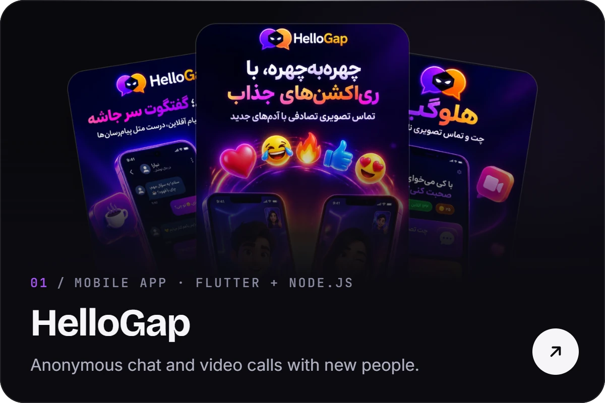
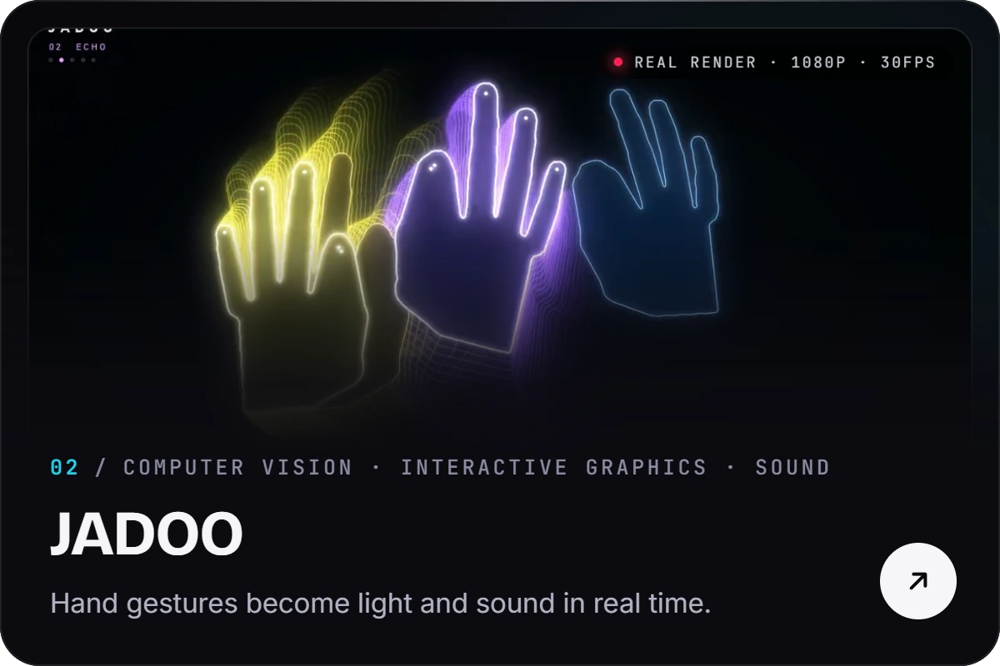
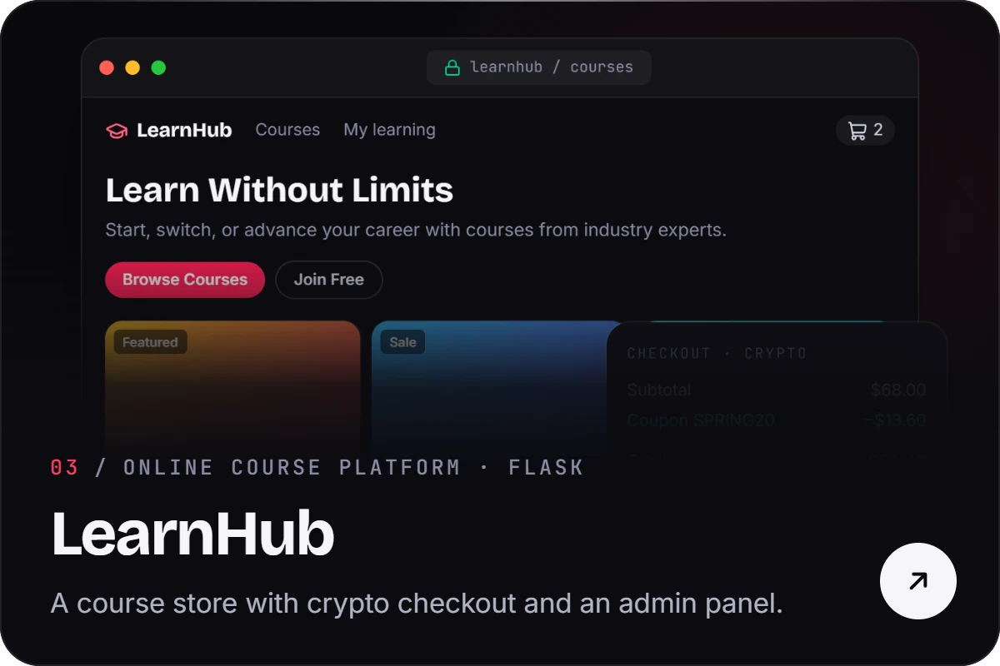
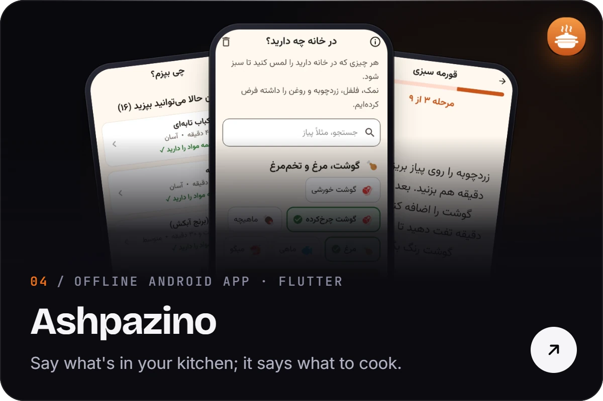
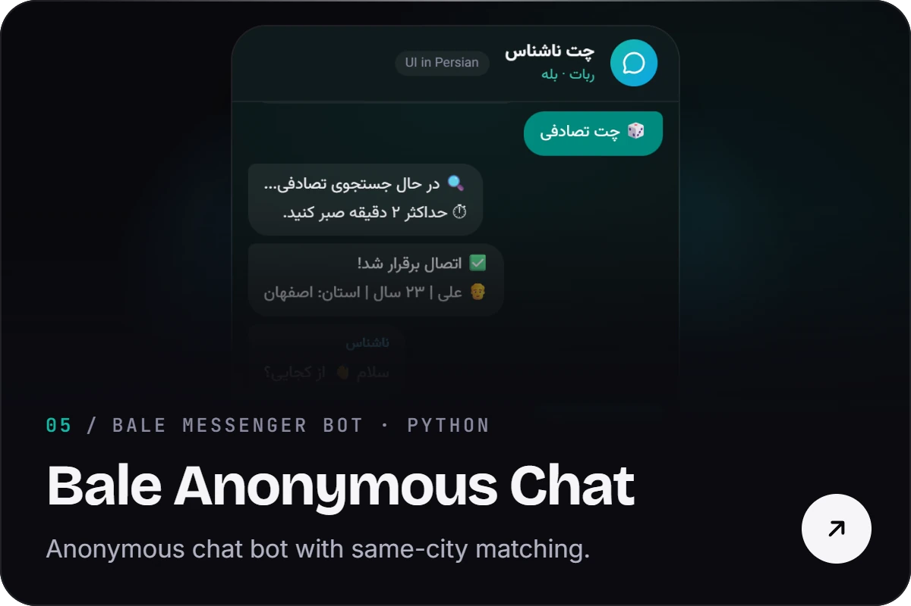
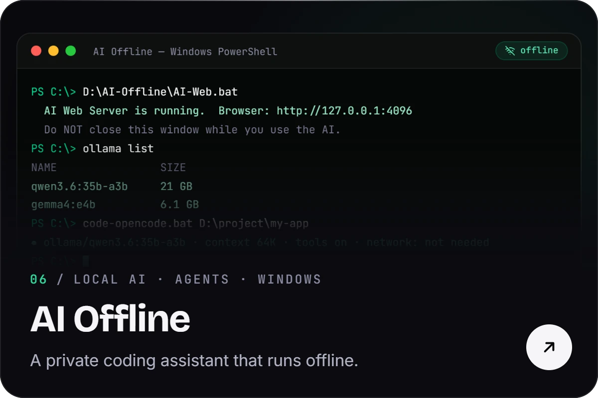
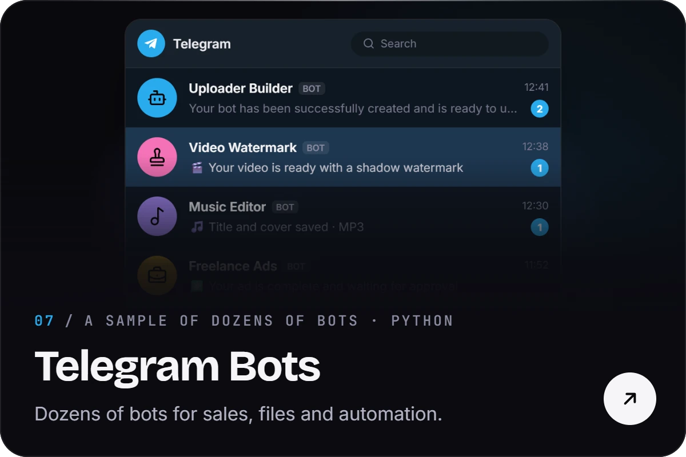
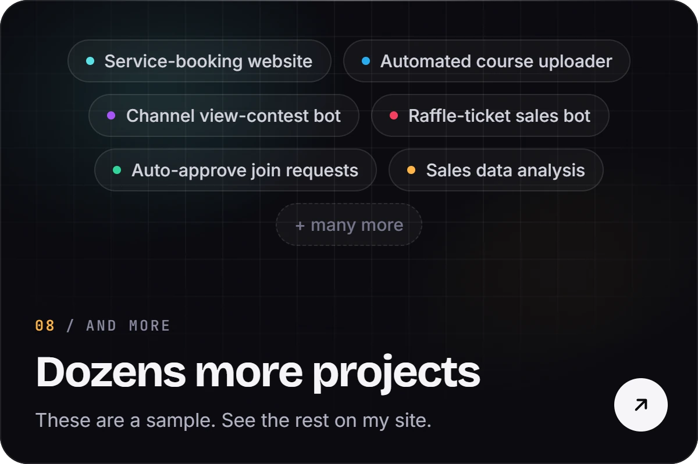
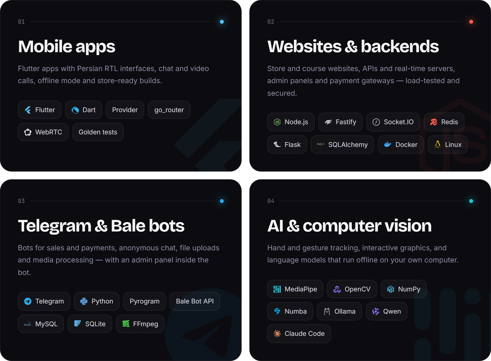

  
  
  

Hi, I'm **Amirhossein Sadani**, a software developer from Iran. I build mobile apps, websites, Telegram and Bale bots, and AI tools, and I usually take a project all the way from the first idea to launch: design, code, server and release.

Most of my work isn't public on GitHub, so here are a few projects to show what I do. They're only a sample; I've built dozens more. You can find more of them on [my site](https://mr-sdn.github.io/?lang=en).

سلام! من **امیرحسین سدنی** هستم، توسعه‌دهندهٔ نرم‌افزار. اپ موبایل، سایت، ربات تلگرام و بله و ابزارهای هوش مصنوعی می‌سازم و پروژه را از ایده تا تحویل خودم جلو می‌برم. این‌ها فقط چند نمونه از کارهای من است؛ نمونه‌کارهای بیشتر در [سایتم](https://mr-sdn.github.io) است. برای انجام پروژه در [تلگرام](https://t.me/amirhosseinsdn) پیام بده.

## Selected work

  
  

  
  

  
  

  
  

## What I build

 

  Have a project in mind? Message me on <a href="https://t.me/amirhosseinsdn">Telegram</a> or <a href="mailto:sdndevelop@gmail.com">email</a>.
   
  The banner and cards are made from <a href="https://github.com/Mr-sdn/Mr-sdn.github.io">my site's code</a>.

